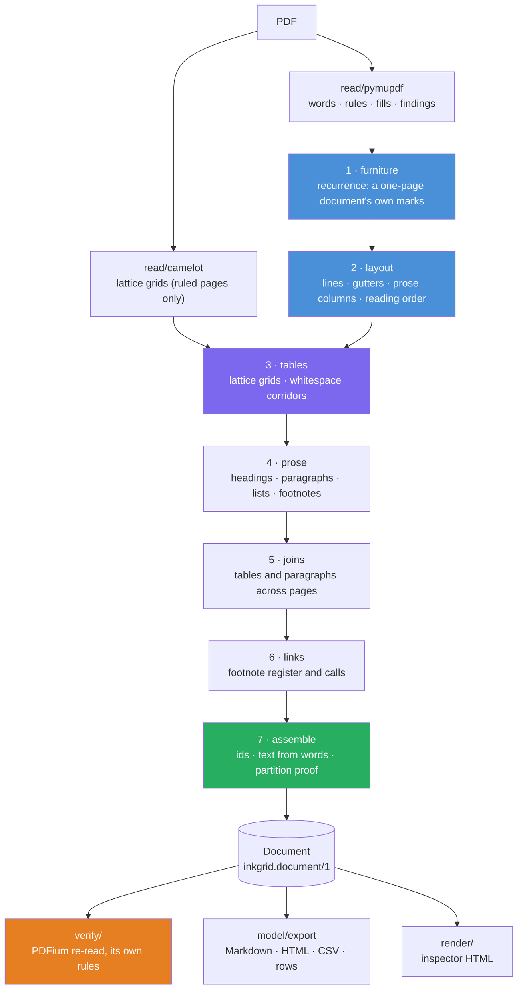

# 📐 `inkgrid`

> 🧾 **Exact tables and text from born-digital PDFs, read from the text layer and checked by a second engine.**
> Every character is one the PDF encodes; every word is owned exactly once; nothing degrades silently.

[📦 PyPI](https://pypi.org/project/inkgrid/) · [📖 Why](https://github.com/Abdul-Muizz1310/inkgrid/blob/v0.2.0/WHY.md) · [🏗️ Architecture](https://github.com/Abdul-Muizz1310/inkgrid/blob/v0.2.0/docs/ARCHITECTURE.md) · [🎬 Demo](https://github.com/Abdul-Muizz1310/inkgrid/blob/v0.2.0/docs/DEMO.md) · [📐 Design](https://github.com/Abdul-Muizz1310/inkgrid/blob/v0.2.0/docs/specs/00-design.md) · [📝 Changelog](https://github.com/Abdul-Muizz1310/inkgrid/blob/v0.2.0/CHANGELOG.md)

[](https://pypi.org/project/inkgrid/)

[](https://github.com/Abdul-Muizz1310/inkgrid/actions/workflows/ci.yml)


[](https://github.com/Abdul-Muizz1310/inkgrid/blob/v0.2.0/LICENSE)

---

```console
$ pip install inkgrid

$ inkgrid read fees.pdf -o fees.json --markdown fees.md
$ inkgrid verify fees.pdf fees.json > report.json && echo "PDFium agrees: no defect"
PDFium agrees: no defect

$ grep -A5 "Standard tariff" fees.md
| Standard tariff | Floor | Scale | Cap |
| --- | --- | --- | --- |
| a) Poster | - | 1.00 bp | - |
| b) Aggressor | CHF 0.50 | 0.55 bp | - |
| c) Auction | CHF 0.50 | 0.75 bp | - |
| Commitment |  | No commitment required |  |
```

---

## 💡 Why this exists

The usual way to pull tables out of a PDF is to render each page and hand the pixels to a vision
model. It works surprisingly well, and it fails quietly: a vision reader can turn a superscript
asterisk into a plus-minus sign or drop a value from a cell, and nothing downstream can tell. A
born-digital PDF already states every character exactly, so inkgrid reads that statement instead,
through the text layer and the drawn rules, and never recognises a glyph from pixels.

It makes correctness a property of the design:

- **No invented text.** Every output character is a codepoint the PDF encodes.
- **No lost or doubled text.** Each document carries a proof that every word is owned exactly once.
- **Independently verified structure.** A verifier re-reads the PDF with a different engine, PDFium,
  and cannot import the code that built the document.
- **Never silent.** Anything degraded (an image-only page, clipped text, an unmapped glyph) becomes a
  typed finding on the result.

What it gives up is pixels: a scanned page has no text layer, and inkgrid reports it
(`no_text_layer`) rather than guessing. On born-digital pages it is measured against OCR and layout
tools on recognised benchmarks below, and it is not the strongest at everything.

## ✨ Features

- 🧱 **Every word in one block** — heading, paragraph, list item, footnote, definition, table or
  furniture, in reading order, with exact coordinates; a proof checks the partition at the end
- 🔤 **Words rebuilt from characters** — a superscript marker against a value stays its own word
  (`$0.40` and `2`, never `$0.402`)
- 📏 **Ruled tables as cell grids** — Camelot's lattice read through its cell edge flags, never its
  DataFrame; a merged cell is one span, so no value is ever copied into the cells it covers
- 🌫️ **Unruled tables from whitespace** — columns from the corridors between value rows; a header set
  in smaller type directly above a table is its header row, and never makes a table of one row
- 📰 **Reading order across columns** — prose columns read one after another, Chinese text included;
  a newspaper's columns under a spanning headline are laid out again in their own width
- 🔁 **Running headers, footers and page numbers** set apart as furniture: by recurrence across pages,
  and on a one-page document by what the page prints (a page number or a page count, or smaller type
  set apart), never a footnote, a table row, a title or a date
- 🔗 **Footnote calls linked to their notes**, and tables and sentences joined across pages
- 📚 **Glossaries and note lists** read as definitions and footnotes
- 📈 **Charts are not tables** — bars proportional to their labels keep the labels as text
- 🧪 **An independent verifier** — `inkgrid verify` grades a reading character by character with
  PDFium: nothing lost, invented or doubled, every cell holding the ink inside it
- 🖼️ **An HTML inspector** that draws every block over its rendered page, defects included
- 🧾 **Exports** — Markdown, HTML with `colspan`/`rowspan`, CSV, and dense rows that flag every
  repeated value; a published JSON Schema for the output contract `inkgrid.document/1`

## 🏗️ Architecture



A pure core sits between two thin shells. Only `inkgrid.read` touches MuPDF and Camelot, and only
the verifier's reader touches PDFium; a test walks the import graph and fails on any edge the layer
table does not allow, so the verifier's independence is structural. Details:
[`docs/ARCHITECTURE.md`](https://github.com/Abdul-Muizz1310/inkgrid/blob/v0.2.0/docs/ARCHITECTURE.md).

## 📁 Project structure

```
inkgrid/
├── src/inkgrid/
│   ├── api.py               # read(), read_pages(), verify(): where the shell meets the core
│   ├── cli.py               # inkgrid read | verify | words
│   ├── model/               # frozen Pydantic models: Document, Block, Grid, Finding, Ledger, ...
│   │   └── export.py        # pure Markdown / HTML / CSV / dense-row rendering
│   ├── read/                # the only modules that import PyMuPDF or Camelot
│   ├── core/                # the pipeline: pure functions over typed values
│   │   ├── furniture.py     # running headers, footers, page numbers
│   │   ├── layout.py        # gutters, prose columns, reading order
│   │   ├── tables/          # lattice and corridor gridders, charts, the grid
│   │   ├── prose.py · notes.py · glossary.py · joins.py
│   │   └── assemble.py      # ids, text from words, the partition proof
│   ├── verify/              # PDFium reader and checks; never imports core or read
│   └── render/inspector.py  # the HTML inspector
├── tests/                   # unit, property and integration tests; fixtures built in the test run
├── bench/                   # the benchmark harness (not shipped): datasets, adapters, scorers
│   ├── inkgrid_bench/       # spec 12's tables, the held-out fee set, the OCR benchmarks
│   └── results/             # every run's report, committed
├── docs/specs/              # 20 specs, cases enumerated before code
└── typings/                 # local stubs for PyMuPDF, Camelot and pypdfium2
```

## 🚀 Quick start

```bash
pip install inkgrid              # or, in a uv project: uv add inkgrid
inkgrid read path/to/file.pdf -o doc.json --markdown out.md --inspector out.html
inkgrid verify path/to/file.pdf doc.json --inspector checked.html   # exit 1 on any defect
inkgrid words path/to/file.pdf --pretty    # the raw page model, for debugging a reading
```

From Python:

```python
import inkgrid

doc = inkgrid.read("fees.pdf")                  # a path, bytes, or a binary stream
for block in doc.blocks:
    print(block.id, block.kind, block.text)
for finding in doc.findings:                    # e.g. no_text_layer on a scanned page
    print(finding.severity, finding.code, finding.detail)
for table in doc.tables():
    print(table.to_html())                      # spans as colspan/rowspan, headers in <thead>
print(doc.to_markdown())                        # furniture left out

report = inkgrid.verify(doc, "fees.pdf")        # PDFium's reading against the document's
print(report.ok, [d.code for d in report.defects])
```

To work on inkgrid itself, from a clone: `uv sync --all-groups`, then the same commands under
`uv run`.

## 💻 CLI reference

| Command | Purpose |
|---|---|
| `inkgrid read PDF [-o OUT] [--markdown MD] [--inspector HTML] [--strict] [--lattice MODE]` | Read a PDF into a `Document` as JSON; `--strict` exits 1 on an error finding |
| `inkgrid verify PDF DOC [-o OUT] [--inspector HTML]` | Grade a `Document` against its PDF with PDFium; exit 1 on any defect |
| `inkgrid words PDF [-o OUT]` | Print the raw page model: words, rules, measurements |
| `--pretty`, `--password-stdin` | Indent the JSON; read an encrypted PDF's password from stdin, never from arguments |

## ⚙️ Configuration

`inkgrid.read(source, *, password=None, lexicon=None, profile=None, lattice="combined", strict=False)`

| Argument | Default | What it sets |
|---|---|---|
| `lexicon` | `Lexicon.default()`, id `generic/1` | Token classes: numbers, money, percent, ranges, placeholders, enumerators, bullets. It never decides structure |
| `profile` | `Profile.default()`, id `default/1` | Geometry tolerances, as ratios of each page's own measurements |
| `lattice` | `"combined"` | Camelot's engine for ruled grids: `"combined"`, `"vector"` (about twice as fast) or `"raster"` |
| `strict` | `False` | Raise `StrictModeError` on an error-severity finding |
| `password` | `None` | An encrypted PDF's password |

A changed lexicon or profile must carry a new id, which the output's `producer` records, so a
document never claims a configuration that did not run.

## 🧱 Stack

| Concern | Choice |
|---|---|
| Text layer and drawings | **PyMuPDF** 1.28 |
| Ruled tables | **Camelot** 2.0 (`lattice="combined"`) |
| Independent verifier | **pypdfium2** 5.13 (PDFium) |
| Models and contract | **Pydantic v2**, frozen, with a published JSON Schema |
| Packaging | **uv** with the `uv_build` backend |
| Lint / Types | **Ruff** + **mypy `--strict`** |
| Tests | **pytest** 9 + **Hypothesis** |
| CI | GitHub Actions: Linux (3.12–3.14), Windows (3.12), macOS (3.14) |

## 🧪 Testing

```bash
uv run pytest                      # unit, property and integration tests, with coverage
uv run pytest -m slow --no-cov     # build the wheel and sdist, smoke-test them
uv run pytest -m heavy --no-cov    # the benchmark tools and scorers, in their pinned environments
scripts/dev.sh                     # every CI gate, in CI's order
```

| Metric | Value |
|---|---|
| **Tests** | 1,952 library tests and 204 harness tests in CI; 11 heavy and 4 slow tests run before a release |
| **Coverage** | 98% line and branch on `src/`, with per-module floors |
| **Specs** | 20 specs under `docs/specs/`, every case a test named after it |
| **Fixtures** | PDFs generated in the test run with exact ground truth, none committed |
| **CI** | ruff → format → mypy → pytest on Linux (3.12–3.14), Windows (3.12), macOS (3.14) |

## 📊 Benchmarks

Every number below is a point estimate with its 95% interval from 10,000 resamples of documents,
under a protocol fixed before anything was scored. **Baseline** is inkgrid as released in 0.1.0, before
any fix designed from that benchmark's failures; **tuned** is its reading after fixes that were. A
held-out set, which no fix has seen, measures whether the fixes carry.

### OCR benchmarks: born-digital text and tables (M7)

Four recognised document-parsing benchmarks, olmOCR-bench, OmniDocBench v1.0, ParseBench and DP-Bench,
score what a reader gets from a page: text, tables, reading order, running headers and footers.
inkgrid reads only a PDF's text layer, so only their born-digital pages and their text and table tests
are scored. A census taken before any tool read a page leaves out scans, OCR layers and pages that are
one picture, and the formula, chart and handwriting tests are not run: 2,238 documents (603, 620, 819
and 196), so no number here stands for a benchmark as a whole. A hash of each document's id splits
each benchmark into a dev half and a test half, fixed before any tool read a page; 0.2.0's fixes
(spec 19) were designed from dev-half failures alone. Every scorer runs unmodified at its pinned
commit, in its own environment. The protocol:
[`docs/specs/18-ocr-benchmarks.md`](https://github.com/Abdul-Muizz1310/inkgrid/blob/v0.2.0/docs/specs/18-ocr-benchmarks.md). The full reports:
[baseline](https://github.com/Abdul-Muizz1310/inkgrid/blob/v0.2.0/bench/results/2026-10-15-00cc5ca-ocr/report.md) and
[tuned, each half apart](https://github.com/Abdul-Muizz1310/inkgrid/blob/v0.2.0/bench/results/2026-10-16-dbc66fc-ocr/report.md).

Higher is better but where a column says ↓ (an Edit distance). A † marks a tool whose paired difference
from inkgrid has an interval excluding 0; the other tools' readings are the same in both runs.

**Baseline: inkgrid 0.1.0 and eight other readers, on all 2,238 documents.**

| Tool | olmOCR-bench born-digital macro | OmniDocBench text, English ↓ | OmniDocBench text, Chinese ↓ | OmniDocBench table TEDS | OmniDocBench reading order ↓ | ParseBench tables (GTRM) | ParseBench text faithfulness | DP-Bench text (NID) |
|---|---|---|---|---|---|---|---|---|
| **inkgrid** | 0.483 | 0.297 | 0.510 | 0.542 | 0.274 | 0.517 | 0.846 | 0.905 |
| pymupdf4llm | 0.807 † | 0.125 † | 0.362 † | 0.786 † | 0.234 † | 0.722 † | 0.847 | 0.903 |
| MarkItDown | 0.353 † | 0.443 † | 0.589 † | 0.103 † | 0.391 † | 0.159 † | 0.864 † | 0.849 † |
| LiteParse | 0.615 † | 0.236 † | 0.441 † | 0.491 | 0.243 | 0.429 † | 0.860 | 0.918 † |
| Docling | 0.818 † | 0.059 † | 0.182 † | 0.738 † | 0.152 † | 0.697 † | 0.854 | 0.912 |
| marker | 0.735 † | 0.077 † | 0.220 † | 0.405 † | 0.228 † | 0.414 † | 0.812 † | 0.865 † |
| Docling, image-only (OCR) | 0.800 † | 0.132 † | 0.193 † | 0.728 † | 0.215 † | 0.667 † | 0.803 † | 0.880 † |
| unstructured `hi_res` (OCR) | 0.509 | 0.136 † | 0.415 † | 0.420 † | 0.268 | 0.363 † | 0.875 † | 0.893 |
| inkgrid on Tesseract's words | 0.387 † | 0.339 | 0.959 † | 0.344 † | 0.380 † | 0.325 † | 0.805 † | 0.905 |

**Tuned (0.2.0), on the test half no fix has seen.** inkgrid's dev-half numbers, which the fixes were
designed on and which overstate it, are the second row.

| Tool | olmOCR-bench born-digital macro | OmniDocBench text, English ↓ | OmniDocBench text, Chinese ↓ | OmniDocBench table TEDS | OmniDocBench reading order ↓ | ParseBench tables (GTRM) | ParseBench text faithfulness | DP-Bench text (NID) |
|---|---|---|---|---|---|---|---|---|
| **inkgrid** | 0.600 | 0.246 | 0.440 | 0.563 | 0.262 | 0.544 | 0.855 | 0.901 |
| inkgrid, dev half (tuned on it) | 0.599 | 0.235 | 0.386 | 0.521 | 0.233 | 0.504 | 0.832 | 0.896 |
| pymupdf4llm | 0.816 † | 0.121 † | 0.366 | 0.801 † | 0.231 | 0.738 † | 0.849 | 0.903 |
| MarkItDown | 0.371 † | 0.440 † | 0.638 † | 0.103 † | 0.391 † | 0.159 † | 0.866 | 0.850 † |
| LiteParse | 0.614 | 0.231 | 0.444 | 0.466 | 0.248 | 0.429 † | 0.864 | 0.928 † |
| Docling | 0.825 † | 0.047 † | 0.181 † | 0.701 † | 0.158 † | 0.702 † | 0.860 | 0.912 |
| marker | 0.758 † | 0.076 † | 0.223 † | 0.352 † | 0.238 | 0.409 † | 0.814 † | 0.863 † |
| Docling, image-only (OCR) | 0.807 † | 0.110 † | 0.181 † | 0.702 † | 0.214 | 0.686 † | 0.818 † | 0.869 † |
| unstructured `hi_res` (OCR) | 0.511 † | 0.120 † | 0.440 | 0.394 † | 0.247 | 0.373 † | 0.881 | 0.894 |
| inkgrid on Tesseract's words | 0.503 † | 0.293 | 0.963 † | 0.377 † | 0.397 † | 0.361 † | 0.816 † | 0.903 |

**What the fixes did, half by half:** inkgrid 0.2.0 against 0.1.0, paired by document (✱: the
difference's interval excludes 0). It is the report's own code over both runs' committed counts, with
0.1.0's inkgrid read as a second tool.

| Metric | Dev half: 0.1.0 → tuned | Difference | Test half: 0.1.0 → tuned | Difference |
|---|---|---|---|---|
| olmOCR-bench headers and footers | 0.264 → 0.556 | +0.292 [+0.222, +0.370] ✱ | 0.304 → 0.606 | +0.302 [+0.235, +0.375] ✱ |
| olmOCR-bench multi-column | 0.613 → 0.674 | +0.061 [+0.015, +0.115] ✱ | 0.617 → 0.651 | +0.034 [+0.009, +0.063] ✱ |
| olmOCR-bench tables | 0.559 → 0.566 | +0.007 [+0.000, +0.023] | 0.535 → 0.542 | +0.007 [+0.000, +0.023] |
| olmOCR-bench born-digital macro | 0.479 → 0.599 | +0.120 [+0.091, +0.151] ✱ | 0.486 → 0.600 | +0.114 [+0.090, +0.141] ✱ |
| OmniDocBench text Edit distance, English ↓ | 0.293 → 0.235 | -0.058 [-0.092, -0.030] ✱ | 0.302 → 0.246 | -0.056 [-0.094, -0.025] ✱ |
| OmniDocBench text Edit distance, Chinese ↓ | 0.512 → 0.386 | -0.126 [-0.179, -0.078] ✱ | 0.507 → 0.440 | -0.067 [-0.108, -0.031] ✱ |
| OmniDocBench table TEDS | 0.521 → 0.521 | +0.000 [+0.000, +0.000] | 0.563 → 0.563 | +0.000 [+0.000, +0.000] |
| OmniDocBench reading-order Edit distance ↓ | 0.274 → 0.233 | -0.041 [-0.069, -0.015] ✱ | 0.274 → 0.262 | -0.012 [-0.031, +0.004] |
| ParseBench GTRM | 0.496 → 0.504 | +0.009 [+0.001, +0.019] ✱ | 0.535 → 0.544 | +0.009 [+0.003, +0.016] ✱ |
| ParseBench TableRecordMatch | 0.329 → 0.342 | +0.013 [+0.002, +0.027] ✱ | 0.357 → 0.373 | +0.016 [+0.005, +0.029] ✱ |
| ParseBench content faithfulness | 0.835 → 0.832 | -0.003 [-0.011, +0.006] | 0.858 → 0.855 | -0.003 [-0.010, +0.006] |
| ParseBench text correctness | 0.879 → 0.869 | -0.009 [-0.014, -0.004] ✱ | 0.901 → 0.889 | -0.011 [-0.017, -0.006] ✱ |
| ParseBench multilingual faithfulness | 0.614 → 0.612 | -0.003 [-0.011, +0.004] | 0.712 → 0.701 | -0.011 [-0.023, -0.002] ✱ |
| DP-Bench NID | 0.903 → 0.896 | -0.007 [-0.016, +0.003] | 0.906 → 0.901 | -0.005 [-0.007, -0.003] ✱ |
| DP-Bench TEDS | 0.682 → 0.682 | +0.000 [+0.000, +0.000] | 0.610 → 0.610 | +0.000 [+0.000, +0.000] |
| DP-Bench MHS | 0.694 → 0.692 | -0.002 [-0.025, +0.027] | 0.657 → 0.639 | -0.018 [-0.048, +0.006] |

- **The fixes carry to the test half.** Every dev-half gain recurs there: one-page furniture doubles
  olmOCR-bench's headers-and-footers rate (0.304 to 0.606), prose columns lift its multi-column tests
  and cut OmniDocBench's text error (English 0.302 to 0.246, Chinese 0.507 to 0.440), and header rows
  lift ParseBench's table scores by about 0.01. So do the costs: ParseBench's text correctness falls by
  0.011 and DP-Bench's NID by 0.005, because both benchmarks count running heads and page numbers as
  text, which inkgrid leaves out.
- **Docling, its image-only run, and pymupdf4llm are ahead of inkgrid** on olmOCR-bench, OmniDocBench's
  English text and both benchmarks' tables. pymupdf4llm reads the text layer through PyMuPDF Layout's
  models. On ParseBench's text and DP-Bench's NID, no difference from Docling or pymupdf4llm is
  distinguishable, and inkgrid is ahead of Docling's image-only run.
- **Against marker and unstructured:** inkgrid's tables are ahead of both (TEDS 0.563 against 0.352 and
  0.394, GTRM 0.544 against 0.409 and 0.373), as are its ParseBench text and DP-Bench NID against
  marker's and its olmOCR-bench rate against unstructured's (0.600 against 0.511). marker is ahead on
  olmOCR-bench and on OmniDocBench's text, and unstructured on OmniDocBench's English text.
- **Against the other text-layer converters:** inkgrid is ahead of MarkItDown on every measure but
  ParseBench's text; against LiteParse it is ahead on ParseBench's tables (0.544 against 0.429), behind
  on DP-Bench's NID (0.901 against 0.928), and otherwise not distinguishable.
- **inkgrid crashed on none** of the 2,238. MarkItDown fails on 7 olmOCR-bench pages; unstructured and
  inkgrid on Tesseract's words pass the 300-second limit on 54 and 59 OmniDocBench newspaper pages,
  most of them again on a second reading. Each scores as an empty page.
- **Speed is not compared here:** the heavy tools read several at a time on one 8-core laptop. The
  held-out fee set below gives each tool's seconds per page, read alone.

### The held-out fee set: 11 fee schedules no fix has seen (M5d)

Fee schedules from 11 exchange groups that none of inkgrid's 42 tuning documents comes from, chosen by
a rule fixed before any tool read them, three seeded pages each: 31 pages and 53 tables. Each table's
grid was drafted from the page's rendering, never from any tool's reading; each cell's text is the
PDF's own words; and every table, with 200 cells glyph by glyph, was checked by hand. Every tool reads
each whole document (146 pages); only its tables on the scored pages count. Eleven documents give wide
intervals. Read again with 0.2.0, inkgrid's tables and the verifier's findings are identical on all 11
documents, so every score is 0.1.0's; this run read each tool alone, so its seconds per page are the
ones to compare. The protocol:
[`docs/specs/16-held-out-fee-set.md`](https://github.com/Abdul-Muizz1310/inkgrid/blob/v0.2.0/docs/specs/16-held-out-fee-set.md); the report:
[`bench/results/2026-10-16-f434a55-heldout/report.md`](https://github.com/Abdul-Muizz1310/inkgrid/blob/v0.2.0/bench/results/2026-10-16-f434a55-heldout/report.md).

| Tool | Structure F | Table regions F | Values bound to all labels | Values found | Cell CER (lower is better) | Seconds per page |
|---|---|---|---|---|---|---|
| **inkgrid** | 0.647 [0.418, 0.849] | 0.818 [0.655, 0.945] | 0.579 [0.363, 0.793] | 0.704 [0.451, 0.899] | 0.098 [0.029, 0.240] | 0.265 [0.198, 0.374] |
| Docling | 0.708 [0.521, 0.867] | 0.895 [0.747, 1.000] † | 0.743 [0.593, 0.865] | 0.932 [0.834, 0.988] † | 0.024 [0.003, 0.055] † | 8.718 [8.052, 9.824] † |
| Docling, image-only (OCR) | 0.707 [0.519, 0.862] | 0.862 [0.661, 1.000] | 0.772 [0.592, 0.892] | 0.923 [0.817, 0.983] † | 0.035 [0.011, 0.083] | 14.435 [10.092, 17.316] † |
| marker | 0.234 [0.114, 0.364] † | 0.850 [0.709, 0.953] | 0.153 [0.047, 0.272] † | 0.459 [0.249, 0.647] | 0.465 [0.273, 0.618] † | 0.474 [0.386, 0.609] † |
| unstructured `hi_res` (OCR) | 0.336 [0.206, 0.473] † | 0.905 [0.839, 0.962] | 0.082 [0.017, 0.175] † | 0.612 [0.388, 0.810] | 0.259 [0.147, 0.352] | 4.461 [4.105, 5.036] † |
| Camelot | 0.476 [0.202, 0.725] | 0.725 [0.496, 0.900] | 0.350 [0.114, 0.627] † | 0.357 [0.115, 0.641] † | 0.308 [0.097, 0.635] † | 0.274 [0.260, 0.301] |
| PyMuPDF | 0.490 [0.259, 0.711] | 0.776 [0.558, 0.939] | 0.320 [0.105, 0.592] † | 0.343 [0.113, 0.622] † | 0.477 [0.222, 0.703] † | 0.062 [0.051, 0.086] † |
| pdfplumber | 0.498 [0.263, 0.711] | 0.714 [0.480, 0.900] | 0.320 [0.105, 0.592] † | 0.343 [0.113, 0.622] † | 0.520 [0.241, 0.760] † | 0.077 [0.064, 0.099] † |
| inkgrid on Tesseract's words | 0.368 [0.218, 0.532] † | 0.809 [0.673, 0.928] | 0.136 [0.028, 0.305] † | 0.468 [0.291, 0.650] † | 0.144 [0.071, 0.265] | 1.731 [1.603, 1.956] † |

A † marks a tool whose paired difference from inkgrid on that metric has an interval excluding 0.
"Values bound to all labels" and "values found" score the truth's access paths (each value with its row
and column labels); cell CER counts glyph errors on the 200 checked cells, each against the closest
cell of the tool's matching table, so a missed table costs all its glyphs. Docling reads the text layer
through its layout and table models, with OCR only where a page has none; its image-only run, and
unstructured, read every page with OCR; marker reads with OCR off. The heavy tools' seconds are a warm
process's on an 8-core laptop, their models loaded.

- **Against the other text-layer readers** (Camelot, PyMuPDF, pdfplumber): inkgrid files more values
  under all their labels (0.579 against 0.320 to 0.350) and finds more of them (0.704 against 0.343 to
  0.357), misreads fewer glyphs (0.098 against 0.308 to 0.520), and its structure recall is higher
  (0.628 against 0.402 to 0.443). Its structure F and table regions are not distinguishable from theirs.
- **Against Docling:** no difference in structure (F 0.647 against 0.708) or in values bound to all
  their labels (0.579 against 0.743) is distinguishable from 0. Docling places tables better (regions F
  0.895 against 0.818), finds more values (0.932 against 0.704), and misreads fewer glyphs (0.024
  against 0.098), at 8.7 seconds a page to inkgrid's 0.27. On the image-only copy, Docling finds more
  values (0.923); no other score's difference from inkgrid is distinguishable, at 14.4 seconds a page.
- **Against marker and unstructured `hi_res`:** inkgrid's structure (F 0.647 against 0.234 and 0.336)
  and values bound to all their labels (0.579 against 0.153 and 0.082) are higher, and marker misreads
  more glyphs (0.465); no difference in table regions is distinguishable.
- **What the text layer gives inkgrid:** fed Tesseract's words instead of the PDF's, inkgrid's
  structure F falls from 0.647 to 0.368 and its values bound to all their labels from 0.579 to 0.136,
  and it runs 6.5 times slower.
- **Where inkgrid fails:** on three of the 11 documents (Borsa Istanbul's data fees, JPX's participant
  fees, LuxSE's listing fees) it binds no value to all its labels and gets few of the tables' cell
  relations right; they hold 283 of its 407 misread glyphs.
- **The verifier** reports 8 cells on these documents, all on one (PSX's trading fees, pages 3 and 4),
  each a word inkgrid's grid cuts in two. **Camelot refuses one document** whose permissions forbid
  text extraction (SET's TFEX fees), scored as no tables; every other tool reads all 11.
- **The truth shares the text layer:** its cell text is the characters inkgrid and the other
  text-layer readers also read, so an OCR tool can misread a glyph where they cannot. Values found and
  cell CER compare the two kinds of tool on those terms.

### Spec 12's table sets: ICDAR-2013 and olmOCR-bench's tables (M5)

inkgrid against pdfplumber 0.11.10, PyMuPDF 1.28.2's `find_tables()` and Camelot 2.0.0's lattice, each
with its defaults. **Baseline** is 0.1.0's reading before the M5c fixes for the errors its verifier
found on these same documents; **0.2.0** is its reading after them and after spec 19, so it is tuned
on these documents (DR-0023). 0.2.0 reads the ICDAR-2013 sets exactly as the M5c tuned run did; on
olmOCR-bench's tables, six pages read differently: three tables gain their header rows, a page
number's junk row is gone, a caption reads as furniture, and a running head read as furniture costs
the table under it its header row. A bold number is ahead of all three peers, every
paired difference's interval excluding 0. The protocol:
[`docs/specs/12-benchmark.md`](https://github.com/Abdul-Muizz1310/inkgrid/blob/v0.2.0/docs/specs/12-benchmark.md); the reports:
[`bench/results/latest.md`](https://github.com/Abdul-Muizz1310/inkgrid/blob/v0.2.0/bench/results/latest.md) (0.2.0, the heavy tools below included) and
[`bench/results/2026-09-29-b33b3cb/report.md`](https://github.com/Abdul-Muizz1310/inkgrid/blob/v0.2.0/bench/results/2026-09-29-b33b3cb/report.md)
(baseline).

| Dataset (documents) | Metric | inkgrid 0.2.0 | inkgrid, baseline | Camelot | PyMuPDF | pdfplumber |
|---|---|---|---|---|---|---|
| ICDAR-2013 competition (67) | Structure F, the competition's scorer | **0.788** [0.711, 0.861] | **0.777** [0.700, 0.850] | 0.637 [0.531, 0.735] | 0.611 [0.512, 0.702] | 0.591 [0.493, 0.683] |
| ICDAR-2013 competition (67) | F1-TEDS, Soric et al.'s protocol | 0.628 [0.466, 0.788] | 0.612 [0.455, 0.767] | 0.624 [0.494, 0.735] | 0.519 [0.384, 0.639] | 0.416 [0.287, 0.545] |
| ICDAR-2013 practice (58) | Structure F, the competition's scorer | **0.688** [0.596, 0.776] | **0.664** [0.569, 0.756] | 0.499 [0.381, 0.611] | 0.457 [0.346, 0.568] | 0.420 [0.314, 0.527] |
| ICDAR-2013 practice (58) | Values filed under their labels | **0.323** [0.199, 0.488] | **0.309** [0.188, 0.469] | 0.251 [0.142, 0.393] | 0.239 [0.135, 0.382] | 0.172 [0.093, 0.280] |
| olmOCR-bench tables (188) | Table tests passed | **0.492** [0.421, 0.564] | **0.481** [0.410, 0.552] | 0.273 [0.213, 0.338] | 0.321 [0.256, 0.390] | 0.294 [0.231, 0.361] |

- **Where inkgrid is ahead:** table structure by the ICDAR competition's own scorer, on both sets,
  mostly through recall; olmOCR-bench's table tests; and values filed under their row and column labels
  (the practice set's 5,603 checkable access paths). That last metric tops out at 0.868 even when the
  ground truth itself is read as a tool, partly because some labels sit outside the value's row and
  column.
- **Where it is not:** under Soric et al.'s protocol no difference from Camelot or PyMuPDF is
  distinguishable from 0, and inkgrid is ahead of pdfplumber on the structure scores but not on table
  boxes.
- **Baseline against 0.2.0:** every 0.2.0 number is higher, but the runs are not paired here and each
  row's intervals overlap, so this benchmark does not show that the fixes raised these scores. What the
  M5c fixes did remove, by design, is what the verifier finds on these documents: 323 defects on 34 of
  the 313 at the baseline, 32 on 7 after.
- **No table tool crashed** on any of the 313 documents. Soric et al.'s own released predictions,
  re-scored with their evaluator, reproduce their results within 0.01 on 15 of 16 numbers.

**OCR, vision and hybrid parsers on the same sets** (M5d-1, measured again at 0.2.0): Docling (by
default and on an image-only copy of each PDF), marker (OCR off), unstructured `hi_res` (Tesseract), and
inkgrid on Tesseract's words. inkgrid is tuned on these documents and they are not, so the comparison
flatters inkgrid. A † marks a tool whose paired difference from inkgrid has an interval excluding 0.

| Dataset (documents) | Metric | inkgrid 0.2.0 | Docling | Docling, image-only (OCR) | marker | unstructured `hi_res` (OCR) | inkgrid on Tesseract's words |
|---|---|---|---|---|---|---|---|
| ICDAR-2013 competition (67) | Structure F, the competition's scorer | 0.788 [0.711, 0.861] | 0.901 [0.857, 0.937] † | 0.880 [0.827, 0.924] † | 0.768 [0.697, 0.833] | 0.465 [0.395, 0.532] † | 0.354 [0.280, 0.428] † |
| ICDAR-2013 competition (67) | F1-TEDS, Soric et al.'s protocol | 0.628 [0.466, 0.788] | 0.894 [0.846, 0.934] † | 0.881 [0.829, 0.923] † | 0.759 [0.682, 0.827] | 0.586 [0.511, 0.655] | 0.341 [0.245, 0.446] † |
| ICDAR-2013 practice (58) | Structure F, the competition's scorer | 0.688 [0.596, 0.776] | 0.847 [0.775, 0.910] † | 0.829 [0.763, 0.888] † | 0.783 [0.708, 0.850] † | 0.468 [0.397, 0.541] † | 0.328 [0.254, 0.405] † |
| ICDAR-2013 practice (58) | Values filed under their labels | 0.323 [0.199, 0.488] | 0.494 [0.329, 0.708] † | 0.473 [0.314, 0.672] † | 0.303 [0.183, 0.464] | 0.074 [0.035, 0.131] † | 0.066 [0.026, 0.128] † |
| olmOCR-bench tables (188) | Table tests passed | 0.492 [0.421, 0.564] | 0.744 [0.692, 0.792] † | 0.736 [0.683, 0.787] † | 0.460 [0.397, 0.521] | 0.413 [0.359, 0.468] | 0.305 [0.254, 0.359] † |

- **Docling is ahead of inkgrid on every one of these**, in both its runs: structure F by 0.09 to 0.16,
  F1-TEDS by 0.25 to 0.27, values filed under their labels by 0.15 to 0.17, and olmOCR-bench's table
  tests by 0.24 to 0.25.
- **marker** is ahead on the practice set's structure (0.783 against 0.688); no other difference from
  inkgrid is distinguishable. **unstructured `hi_res`** trails inkgrid on structure, on both sets, and on
  values filed under their labels.
- **On Tesseract's words**, inkgrid trails itself on every metric (structure F 0.354 and 0.328, against
  0.788 and 0.688): the text layer, not the gridders alone, is what puts inkgrid where it is.

Not measured: FinTabNet, of which no official source of the PDFs remains.

## 🧭 Engineering philosophy

| Principle | How it shows up |
|---|---|
| 🔴 **Spec-TDD** | Every milestone starts as a spec with enumerated cases; each case is a test named after it, watched failing before its code |
| 🚫 **Negative-space programming** | A `Document` that exists satisfies its invariants: the partition, cells that tile their grid, links to blocks that exist |
| 🧊 **Pure core, imperative shell** | Only `read/` touches MuPDF and Camelot, only `verify/`'s reader PDFium; every pipeline stage is a pure function |
| 🔒 **Typed everything** | `mypy --strict`, frozen Pydantic models, closed enums for findings and defects, local stubs for untyped libraries |
| 📏 **Measure before building** | Every rule was traced on real documents first; benchmark claims come from a pre-registered protocol with intervals |
| 🧪 **Honest numbers** | Baseline before any fix, fixes labelled tuned, and a held-out half no fix has seen |

## ⚠️ Scope & limitations

- **Born-digital PDFs only.** A scanned page has no text layer: inkgrid reports `no_text_layer` and
  reads nothing there. Math formulas, charts and pictures are read as their text, if any.
- **Text is judged hidden from the text layer alone.** Text under an opaque shape or white on white
  reads as visible, to the verifier too.
- **Left-to-right scripts only.** Right-to-left and bidirectional text is not reordered.
- **Unruled tables have no row spans,** and a table needs a value: a table of text alone with no
  ruled grid reads as paragraphs.
- **One-page furniture is read from the page's own marks**, so a few lines at a one-page document's
  edge read as running heads or feet, their words kept as furniture and out of the Markdown: a
  numbered heading that opens it (`1 Introduction`), a title or caption in body type ending in a
  number (`Table 23`), a two-column table's last row ending in an integer, and the last line of a
  double-spaced page ending in a number.
- **A call resolves forward only,** and only page breaks join a paragraph.
- **Untrusted PDFs belong in a separate process** with resource limits: MuPDF parses in memory.

## 🚦 Status

| Milestone | Status |
|---|---|
| 0.2.0 on [PyPI](https://pypi.org/project/inkgrid/) | ✅ 2026-10-16 |
| M0–M6: the reader, tables, links, verifier, benchmark, release | ✅ |
| M7: OCR benchmarks on born-digital pages, and the fixes they showed | ✅ |
| CI on Linux, Windows and macOS | ✅ |

## 📜 License

inkgrid's own code is MIT; see
[LICENSE](https://github.com/Abdul-Muizz1310/inkgrid/blob/v0.2.0/LICENSE).

**Read this before you ship inkgrid in a product.** inkgrid requires
[PyMuPDF](https://pymupdf.readthedocs.io/en/latest/about.html#license-and-copyright), which Artifex
dual-licenses under the GNU AGPL-3.0 or a commercial license. Software distributed or served over a
network with inkgrid must meet the AGPL's terms for the combined work, unless you hold Artifex's
commercial license. This is not legal advice.

The other dependencies are permissively licensed: Camelot (MIT), Pydantic (MIT), OpenCV (Apache-2.0),
pypdfium2 (Apache-2.0 or BSD-3-Clause), pandas and NumPy (BSD-3-Clause). OpenCV is pinned away from
5.0.0.93, whose bundled FFmpeg lacks the CVE-2026-8461 fix.

---

> 📐 *Read what the page states; prove you read all of it.*
